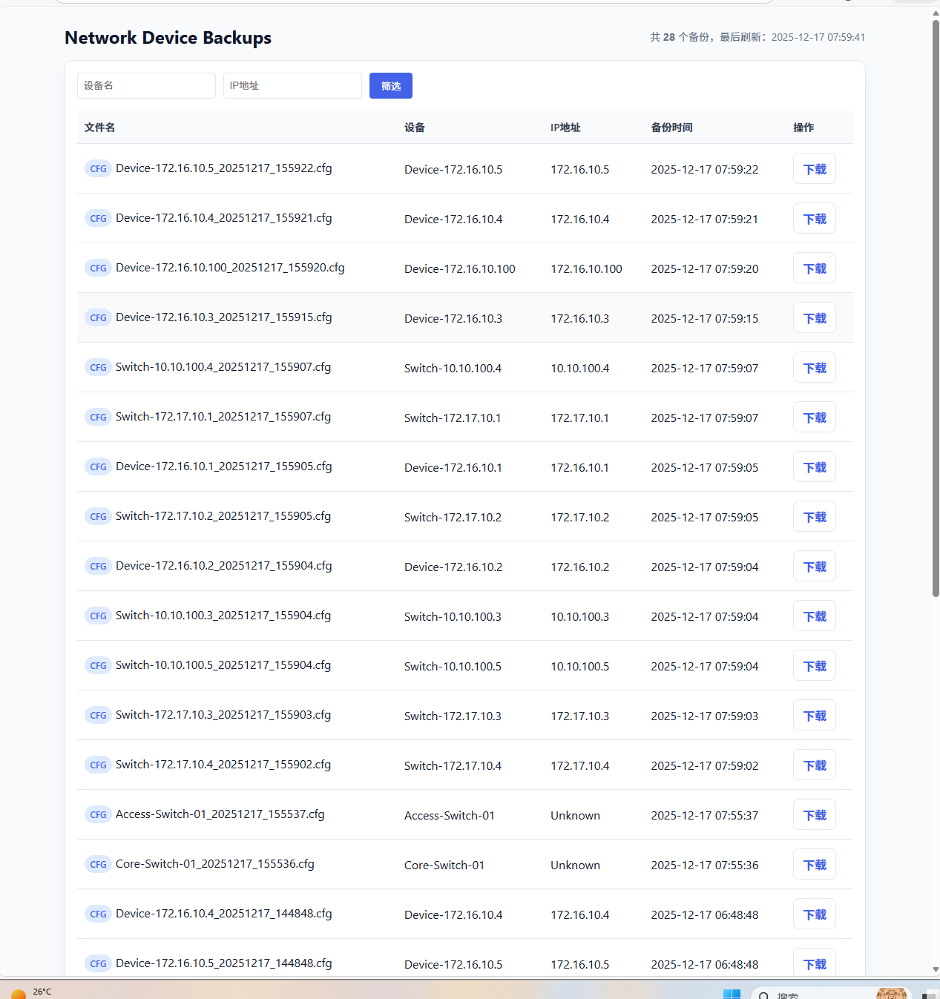
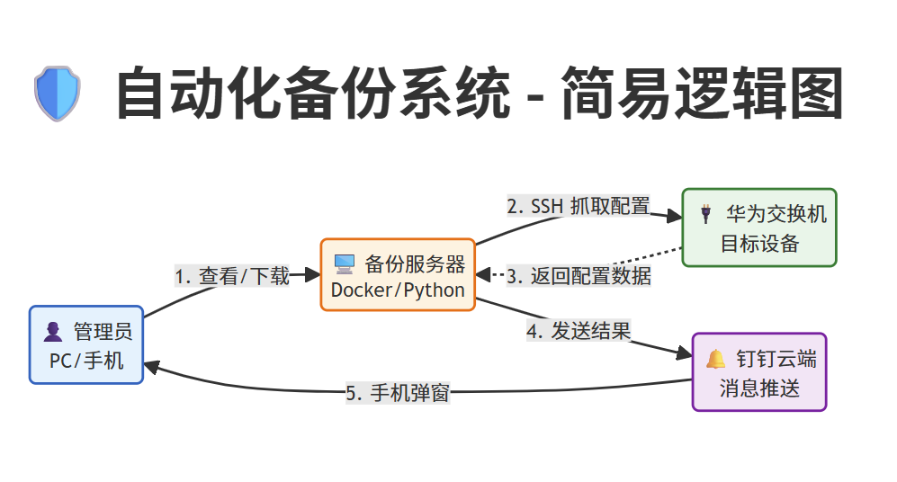
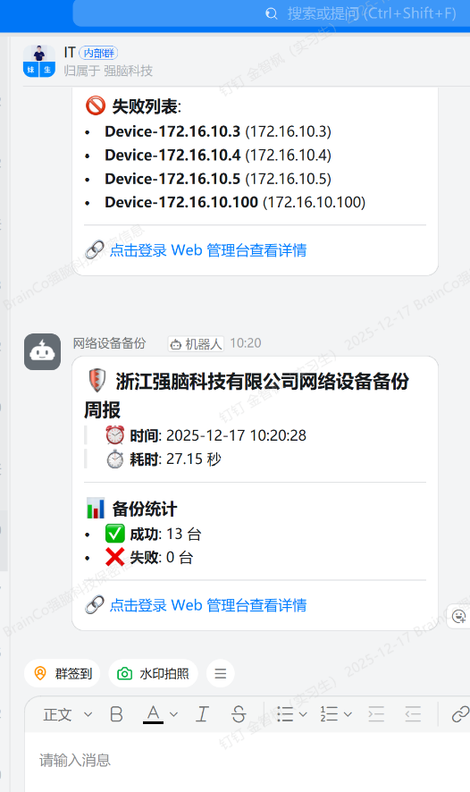

<!-- engineering-guide:start -->
## 🧭 工程导读 · 从场景到实现

**网络设备配置备份与结果可见性**。减少逐台登录华为网络设备导出配置的重复操作，将配置采集、文件留存、浏览下载与通知汇总连接起来。

- ThreadPoolExecutor 按 MAX_WORKERS 并发执行设备采集，并汇总成功、失败和任务耗时。
- 配置文件按设备名与北京时间戳命名，Web 页面按设备名和 IP 筛选并提供下载。
- 采集通过交互式 SSH 发送华为配置命令，设备命令差异和退出条件需要在测试设备上确认。

📖 **[阅读完整工程导读](docs/PROJECT_GUIDE.md)**：源码路径、最短运行路线、演示验收与当前边界。
<!-- engineering-guide:end -->

## ✨ 项目速览

- 自动采集华为设备配置，集中保存备份文件，为人工巡检与配置留存提供自动化入口。
- Web 页面支持按设备名与 IP 筛选备份，按时间查看并下载历史配置。
- 将备份执行、文件浏览与钉钉通知串联，配套容器部署与定时任务说明。

### 🧭 源码阅读路线

- **[备份采集](backup_network_devices.py)**
- **[文件管理](app.py)**
- **[设备模板](devices.example.json)**
- **[容器构建](Dockerfile)**

### 🖼️ 项目界面

---

# **🛡️ 企业级网络设备自动化备份系统 (Enterprise Network Auto-Backup System)**

**项目简介**：这是一个基于 Docker 容器化部署的自动化运维解决方案，专为企业内网环境设计。它能够定时自动抓取华为网络设备（交换机/防火墙）的配置文件，提供可视化的 Web 管理界面进行下载，并通过钉钉机器人实时推送备份报告。

## **🚀 项目背景 (Background)**

在企业网络运维中，随着设备数量的增加，人工登录每一台交换机进行配置备份不仅效率低下，而且容易遗漏。为了解决这一痛点，保障网络配置数据的安全与可追溯性，开发了这套自动化备份系统。

**主要解决痛点：**

* **效率低下**：消除人工 SSH 登录备份的重复性劳动。  
* **管理混乱**：解决备份文件分散、版本管理混乱的问题。  
* **缺乏监控**：实现备份结果的实时监控与告警，确保数据安全。

## **✨ 核心功能 (Features)**

* **⚡ 自动化备份**：支持 Crontab 定时任务，全自动执行，无需人工干预。  
* **🐳 容器化部署**：基于 Docker，环境隔离，一键迁移，支持 X86 架构，部署极速。  
* **📱 实时告警**：集成钉钉 Webhook，备份成功/失败实时推送到手机，支持 Markdown 格式美化。  
* **🌐 Web 管理**：内置 Flask 文件服务器，可通过浏览器随时查看和下载历史备份文件。  
* **🛡️ 广泛兼容**：完美支持华为（Huawei）交换机及防火墙（USG系列）。  
* **🔧 智能交互**：针对老旧设备优化 SSH 算法，支持自动分页处理，增强抗超时能力。

## **🏗️ 系统架构 (Architecture)**

系统采用典型的 C/S 架构，服务器端通过 SSH 轮询采集设备配置，并持久化存储到本地磁盘。

## **🛠 技术栈 (Tech Stack)**

| 模块 | 技术选型 | 说明 |
| :---- | :---- | :---- |
| **操作系统** | Ubuntu Server 22.04 LTS | 稳定可靠的宿主机环境 |
| **容器化** | Docker | 环境标准化，实现“一次构建，到处运行” |
| **编程语言** | Python 3.9 | 核心逻辑实现，基于 python:3.9-slim |
| **SSH 交互** | Paramiko 3.4.0 | 处理复杂的网络设备 SSH 交互 |
| **Web 服务** | Flask 3.0.3 | 轻量级 Web 框架，提供文件下载服务 |
| **通知渠道** | Requests | 发送钉钉群机器人消息 |
| **任务调度** | Linux Crontab | 负责周期性任务的触发 |

## **📋 环境准备 (Prerequisites)**

在开始部署前，请确保服务器满足以下要求：

* **硬件**：2核 CPU / 4G 内存 / 50G 硬盘及以上。  
* **OS**：推荐 Ubuntu Server 22.04 LTS。  
* **网络**：服务器需配置**静态 IP**，且能访问目标交换机的 SSH (Port 22)。

### **1\. 操作系统安装与配置**

推荐使用 Ubuntu Server 22.04 LTS。

**⚠️ 关键点**：安装向导询问 Install OpenSSH server? 时，必须勾选 \[x\]，否则无法远程。

### **2\. 配置静态 IP (Static IP)**

服务器必须固定 IP，否则 Web 访问和钉钉链接会失效。

编辑 Netplan 配置文件：

sudo nano /etc/netplan/01-network-manager-all.yaml

写入配置 (示例，请根据实际环境修改)：

network:  
  version: 2  
  renderer: NetworkManager  
  ethernets:  
    ens33: \# 请根据实际网卡名修改(如 ens160)  
      dhcp4: no  
      addresses: \[192.168.77.3/24\]  \# 服务器 IP  
      routes:  
        \- to: default  
          via: 192.168.77.254       \# 网关  
      nameservers:  
        addresses: \[114.114.114.114, 223.5.5.5\]

应用配置：sudo chmod 600 /etc/netplan/01-network-manager-all.yaml && sudo netplan apply

## **⚡ 快速部署 (Deployment)**

### **1\. 环境初始化**

\# 切换到 root  
sudo \-i

\# 安装 Docker 与 Git  
apt update  
apt install \-y docker.io git

\# 配置 Docker 权限 (免 sudo)  
usermod \-aG docker $USER

### **2\. 配置 Docker 镜像加速与网段 (🔥关键)**

防止 Docker 网段 (172.17.x.x) 与局域网设备冲突，并加速下载。

mkdir \-p /etc/docker  
tee /etc/docker/daemon.json \<\<-'EOF'  
{  
  "registry-mirrors": \[  
    "\[https://docker.m.daocloud.io\](https://docker.m.daocloud.io)",  
    "\[https://huecker.io\](https://huecker.io)"  
  \],  
  "bip": "192.168.200.1/24"   
}  
EOF  
systemctl daemon-reload  
systemctl restart docker

### **3\. 拉取代码**

git clone \[https://github.com/zhifengjin050-arch/network-backup.git\](https://github.com/zhifengjin050-arch/network-backup.git)  
cd network-backup

## **⚙️ 配置指南 (Configuration)**

### **1\. 配置设备清单 (devices.json)**

在此处填入所有需要备份的华为设备信息。

cp devices.example.json devices.json  
nano devices.json

**格式示例**：

{  
  "devices": \[  
    {  
      "hostname": "Core-Switch-01",  
      "ip": "10.10.100.1",  
      "username": "admin",  
      "password": "YourPassword",  
      "device\_type": "huawei"  
    }  
  \]  
}

### **2\. 修改核心参数 (backup\_network\_devices.py)**

编辑脚本，配置钉钉 Token 和服务器 IP：

vim  backup_network_devices.py

\# 1\. 钉钉 Webhook  
DINGTALK\_WEBHOOK \= "\[https://oapi.dingtalk.com/robot/send?access\_token=xxxx\](https://oapi.dingtalk.com/robot/send?access\_token=xxxx)"

\# 2\. 服务器 IP (用于生成跳转链接)  
SERVER\_IP \= "192.168.77.3" \# 替换为你服务器的真实IP

### **3\. 构建并启动容器**

\# 构建镜像  
sudo docker build \-t network-backup .

\# 启动容器 (挂载本地目录以持久化保存备份)  
\# 注意：加上 \--dns 参数以防容器内 DNS 解析失败  
sudo docker run \-d \\  
  \--dns 223.5.5.5 \\  
  \-p 5000:5000 \\  
  \-v $(pwd)/backups:/app/backups \\  
  \--name net-backup \\  
  network-backup

## **🕹️ 日常运维 (Operations)**

### **🟢 手动触发备份**

sudo docker exec \-it net-backup python backup\_network\_devices.py

**成功标志**：终端显示 "Backup successful"，钉钉群收到带链接的消息，点击链接能跳转。

### **⏰ 设置定时任务**

编辑宿主机 Crontab (crontab \-e)，添加如下规则（每周五 17:30 执行）：

30 17 \* \* 5 docker exec net-backup python /app/backup\_network\_devices.py \>\> /tmp/backup.log 2\>&1

### **🌐 访问 Web 界面**

打开浏览器访问：http://\<服务器IP\>:5000

## **❓ 故障排查 (Troubleshooting)**

| 问题现象 | 可能原因 | 解决方案 |
| :---- | :---- | :---- |
| **钉钉报错 NameResolutionError** | 容器内 DNS 解析失败 | 启动容器时添加 \--dns 223.5.5.5 参数 |
| **连不上 172.17.x.x 的交换机** | Docker 默认网段冲突 | 修改 daemon.json 中的 "bip": "192.168.200.1/24" |
| **交换机报错 Connection refused** | 目标未开 SSH | 登录交换机 Web 后台，开启 Stelnet (SSH) 并允许 Port 22 |
| **报错 Error reading SSH banner** | 设备响应过慢 | 最新版代码已将 timeout 调整为 60s 以适配老旧设备 |

## **📜 License**

MIT License © 2025 Zhifeng Jin
